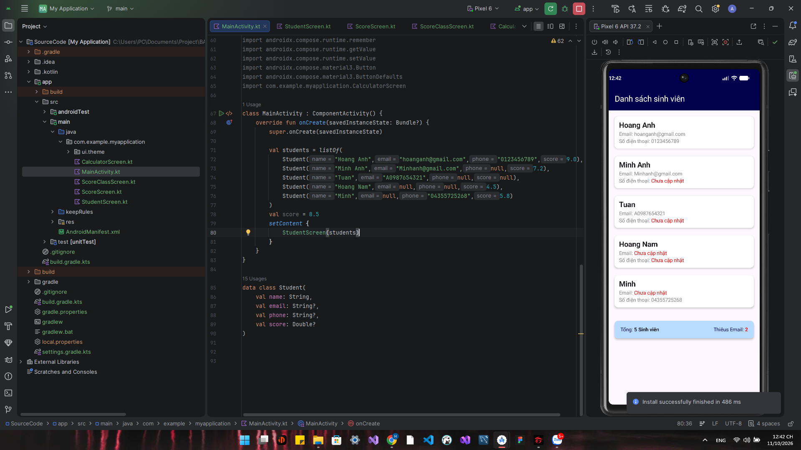
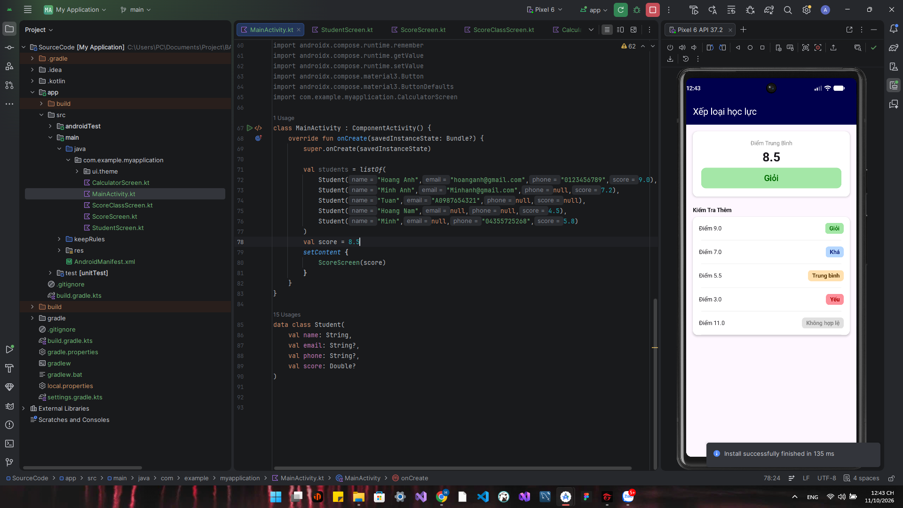
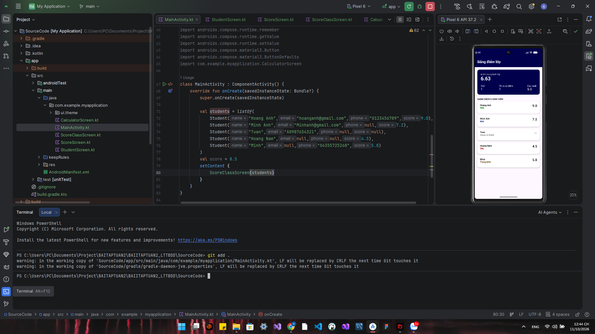
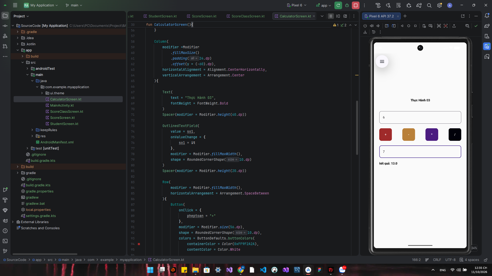

# BAIITAPTUAN2_LTTBDD
## 1. Mô tả bài tập

Bài tập được thực hiện bằng **Kotlin và Jetpack Compose** trên Android Studio.

Nội dung bài tập gồm các màn hình thực hành nhằm làm quen với các kiến thức cơ bản của Kotlin và xây dựng giao diện Android bằng Jetpack Compose.

Các nội dung chính:

- Sử dụng vòng lặp `for`.
- Xử lý kiểu dữ liệu Nullable.
- Sử dụng câu lệnh `if / else`.
- Hiển thị danh sách sinh viên.
- Tính toán và thống kê điểm sinh viên.
- Xử lý dữ liệu nhập từ `TextField`.
- Quản lý trạng thái bằng `remember` và `mutableStateOf`.
- Thực hiện các phép tính cơ bản.

---

## 2. Mục tiêu

Sau khi hoàn thành bài tập, có thể:

- Hiểu cách khai báo và sử dụng `data class` trong Kotlin.
- Sử dụng `List` để lưu trữ dữ liệu.
- Duyệt danh sách bằng vòng lặp `for`.
- Xử lý dữ liệu có thể `null`.
- Sử dụng `if / else` để xử lý điều kiện.
- Xây dựng giao diện bằng Jetpack Compose.
- Sử dụng các thành phần như:
    - `Scaffold`
    - `TopAppBar`
    - `Column`
    - `Row`
    - `Card`
    - `Text`
    - `Spacer`
    - `Button`
    - `OutlinedTextField`
- Quản lý trạng thái giao diện.
- Hiển thị dữ liệu động lên màn hình.

---
## 3. Hình ảnh kết quả

### Bài 1 - Danh sách sinh viên

  

### Bài 2 - Xếp loại học lực

  

### Bài 3 - Bảng điểm lớp

  

### Bài 4 - Máy tính cơ bản

  

